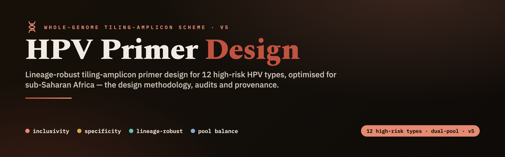
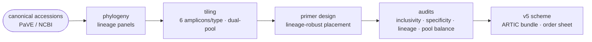

<!-- banner -->


<p align="center">
  
  
  
  
  
</p>

<p align="center"><b>A whole-genome tiling-amplicon primer scheme (v5) for 12 high-risk HPV types —<br>lineage-robust for sub-Saharan Africa.</b></p>

---

Design project for a **whole-genome tiling-amplicon primer scheme** covering **12 high-risk HPV
types**, optimised to be **lineage-robust for sub-Saharan Africa**. This public repository holds the
**design methodology**: the scheme-generation code, the public reference set, and the design record.

> **Availability.** The **final v5 scheme outputs** (primer sequences, per-type schemes, the ARTIC
> analysis bundle), the **methods report**, and the per-primer **audit/provenance** tables are **held
> privately during review** and are **not** included in this public repository — available on request.

> The **analysis pipeline** that *consumes* this design lives in a separate repository,
> **`hpv-nanopore-pipeline`**. It ingests the v5 scheme bundle produced here (see
> `hpv-analysis-bundle/`) to reconstruct HPV whole genomes from Oxford Nanopore reads.

## Design workflow



> The `design-scripts/` (t1–t5) implement this flow; the resulting scheme, audits and report are the
> private outputs noted above.

## What the design is
- **12 high-risk types:** HPV 16, 18, 31, 33, 35, 39, 45, 52, 56, 58, 59, 66.
- **6 amplicons per type, dual-pool (Pool 1 / Pool 2)**, tiling the full ~7.8–7.9 kb circular
  genome, including one **origin-spanning junction amplicon** (amp3) per type.
- **Lineage-robust** primer placement validated against African and global lineage panels
  (inclusivity / specificity / lineage audits in `reports/`).
- **Scheme version: v5 (final).**

## Canonical reference accessions (per type)
Primers and per-type reference sequences are derived from these **public** PaVE/NCBI canonical
accessions (small and redistributable; per-type reference FASTA is in `hpv-analysis-bundle/references/`):

| Type | Clade | Accession | | Type | Clade | Accession |
|------|-------|-----------|-|------|-------|-----------|
| HPV16 | Alpha9 | K02718 | | HPV45 | Alpha7 | X74479 |
| HPV18 | Alpha7 | X05015 | | HPV52 | Alpha9 | X74481 |
| HPV31 | Alpha9 | J04353 | | HPV56 | Alpha6 | X74483 |
| HPV33 | Alpha9 | M12732 | | HPV58 | Alpha9 | D90400 |
| HPV35 | Alpha9 | X74477 | | HPV59 | Alpha7 | X77858 |
| HPV39 | Alpha7 | M62849 | | HPV66 | Alpha6 | U31794 |

Per-type clade, genome length, junction-amplicon and degenerate-primer counts are recorded in the
private scheme summary (available on request).

## Repository layout (public)
```
design-scripts/               the v5 design pipeline (acquisition, tree, audits, QC)
prepare_design_bundle.py      build the analysis bundle from the v5 scheme (needs the private outputs)
convert_scheme_to_artic.py    upgrade an installed scheme tree to the ARTIC 1.10.1 layout
hpv-analysis-bundle/
  references/                 hpv_all_types.fasta (12 canonical, public genomes)
  sample_sheet_TEMPLATE.csv, BUNDLE_VERSION
LICENSE-*, CITATION.cff, README.md
```
**Held privately** (available on request): the per-type primer/amplicon/scheme outputs
(`design-outputs/`), the ARTIC primer schemes (`hpv-analysis-bundle/primer-schemes/`), the per-primer
coordinate/audit tables, and the reports (`METHODS_REPORT`, order sheet, inclusivity/specificity/lineage/
pool audits, figures, trees).

## Regenerating the analysis bundle
The bundle is the design→analysis handoff. Rebuilding it requires the private v5 scheme outputs
(`design-outputs/`, available on request); with those in place:

```bash
python prepare_design_bundle.py            # -> ./hpv-analysis-bundle/ (+ SHA256SUMS)
```

It emits canonical-accession references with ARTIC-1.10.1-compatible chrom names
(`HPV{type}_{accession}`), the per-type `primer.bed` + `reference.fasta` in both the nested
ARTIC layout (`HPV{t}/2000/v5.0.0/`) and the legacy `HPV{t}/V5/` layout, plus `index.json`,
`scheme_summary.tsv`, a `sample_sheet_TEMPLATE.csv`, and `SHA256SUMS`.

## What is intentionally NOT in this repo
Large or non-redistributable inputs are **not** stored here — only the design code and the public
reference genomes. Excluded (regenerate or fetch as needed): raw multi-type
genome panels and lineage alignments, BLAST databases (`hpvdb.*`), the human/off-target
reference sets (e.g. GRCh38), phylogeny intermediates (large alignments / distance matrices),
and any sequencing data. The public source accessions are listed above, so the inputs are fully traceable.

## Downstream
Analysis (CPU-only Nanopore consensus + variant calling, validated end-to-end on ARTIC +
Clair3) is in **`hpv-nanopore-pipeline`**, which consumes this design's **scheme v5** bundle.

## License
This repository is **dual-licensed by file type**:
- **Code → MIT** (`LICENSE-MIT.txt`): all scripts/source — `*.py`, `*.sh`, `Snakefile`,
  `*.nf`, `*.lua`, `*.yml`/`*.yaml`, `nextflow.config` and similar.
- **Data & documents → CC-BY-4.0** (`LICENSE-CC-BY-4.0.txt`): the primer-scheme files
  (`primer.bed`, `reference.fasta`), the `*.tsv` outputs (`primer_order_sheet_v5.tsv`,
  `scheme_summary.tsv`, `coordinate_rederivation.tsv`, inclusivity/specificity/lineage
  tables), `MANIFEST.txt`/`SHA256SUMS`/`index.json`, the reports (`METHODS_REPORT.*`,
  `FINAL_REPORT_*`), and all figures.

**CC-BY attribution:** Bright Adu, ORCID 0000-0002-3622-2137, Genomics and Bioinformatics
Core, NMIMR, University of Ghana, Legon, Ghana. **Cite via `CITATION.cff`** (details in
`LICENSE-NOTICE.md`).

*Ambiguous files (assignment stated):* `*.yml` env specs, `nextflow.config`, `*.lua`,
`preamble.tex` → **MIT** (build/source config); `sample_sheet_TEMPLATE.csv` → **CC-BY-4.0**
(data template); `index.json`, `MANIFEST.txt`, `SHA256SUMS`, `*.fai` → **CC-BY-4.0**
(data/metadata). GitHub may show "View license" rather than one SPDX badge for a
dual-licensed repo — expected, not an error.
